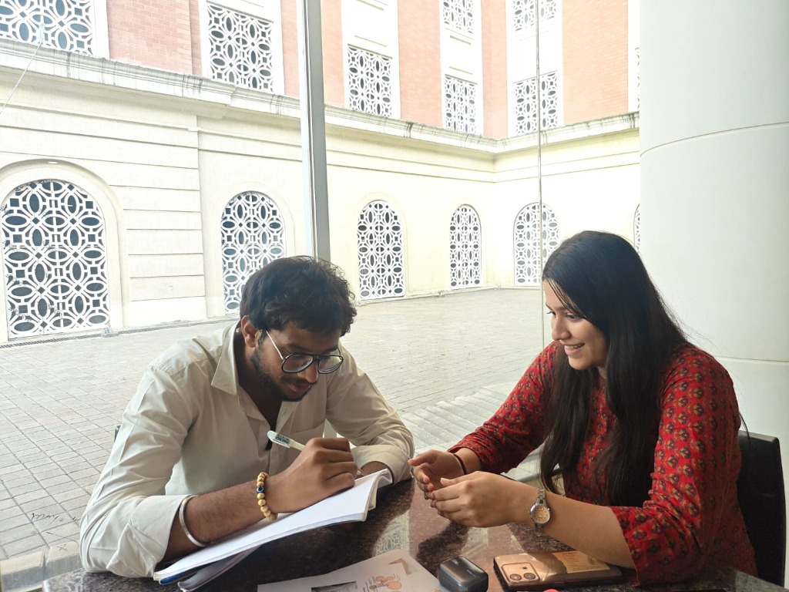
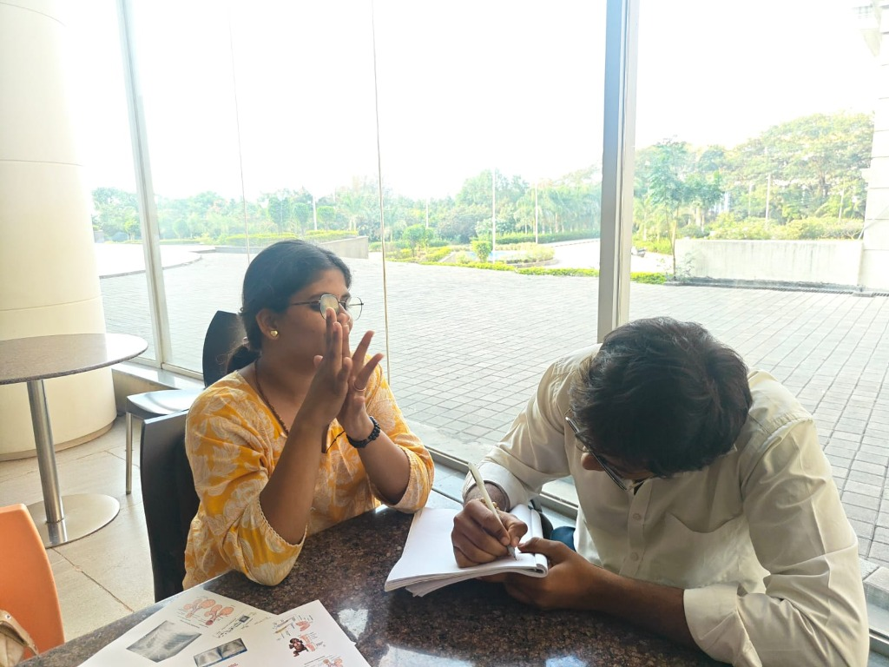
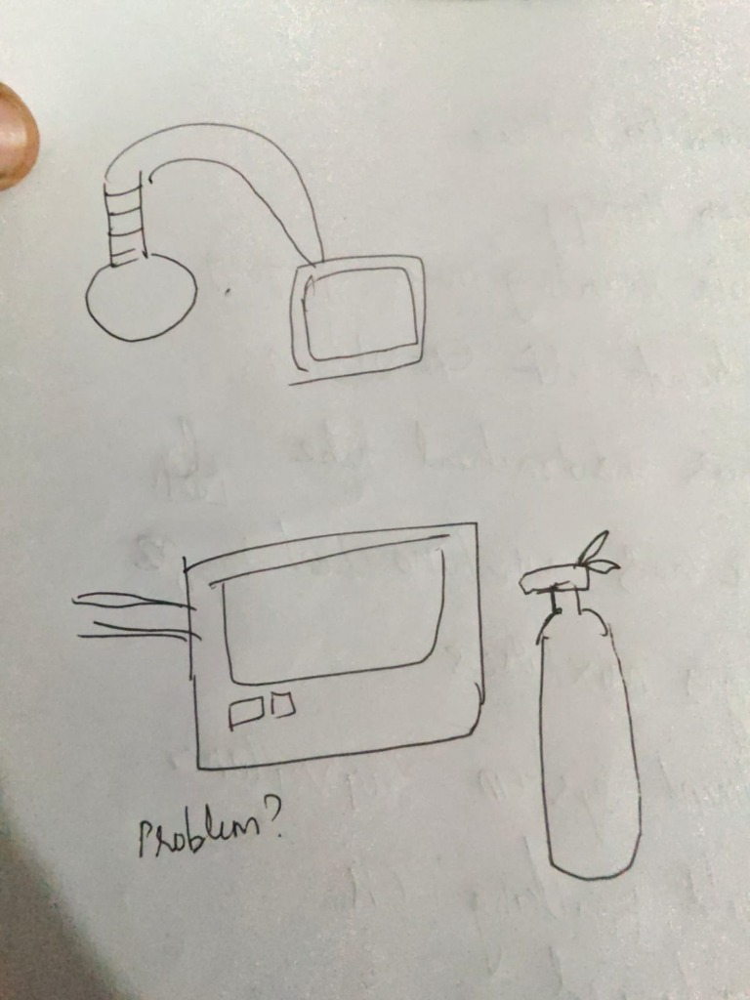
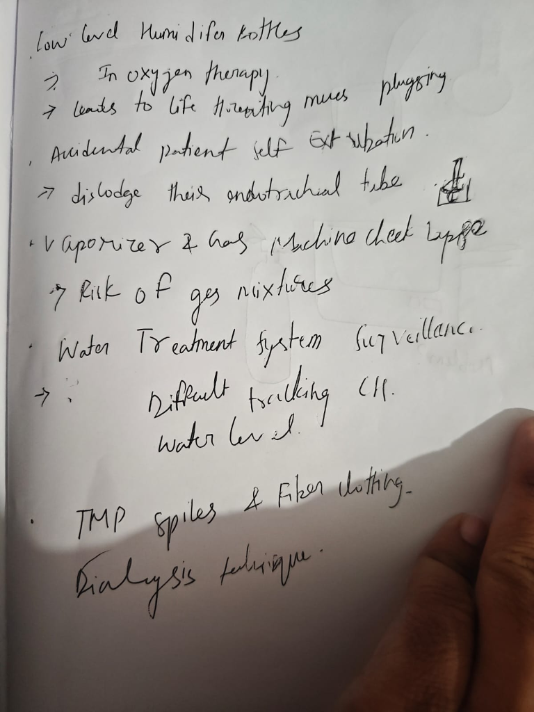
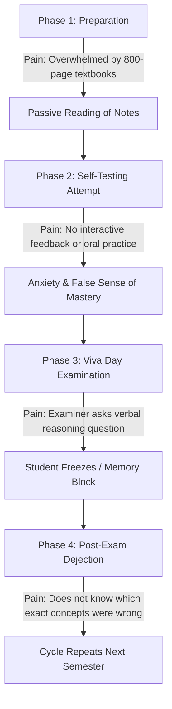
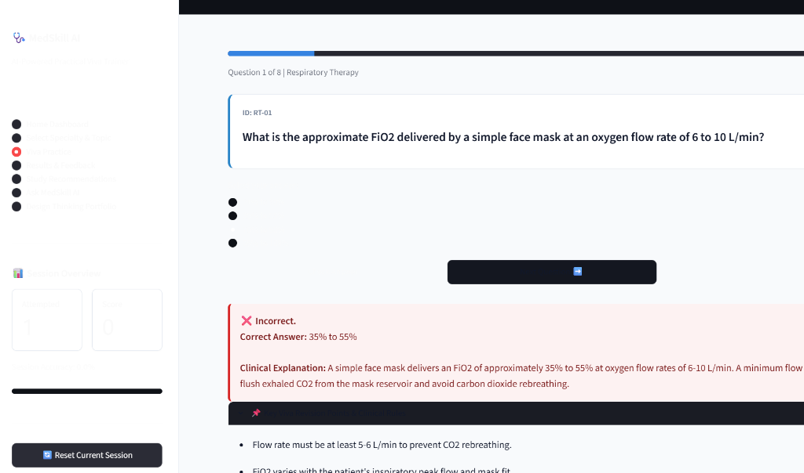
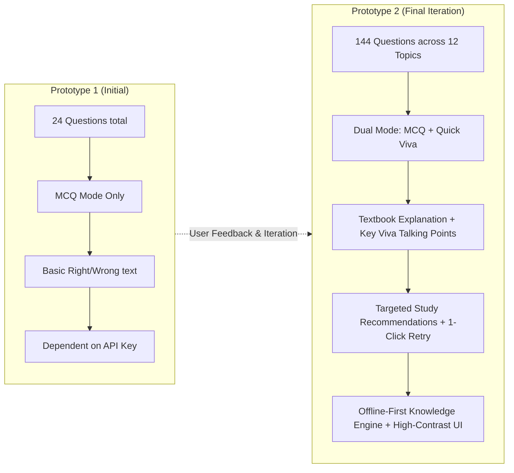

# CA2 — Activity 13: Design Thinking Project
## Design for the Unseen — A Human-Centered Innovation Challenge
**Department of Robotics & Automation | Academic Year 2026-27 | Batch 2024-28, Semester - V**  
**Course Assignment:** CA2 - Activity 13 (40 Marks Evaluation)  
**Project Title:** **MedSkill AI — AI-Powered Practical Viva Trainer for Healthcare Technology Students**  
**Live Deployed Application:** [https://medskill-ai.streamlit.app/](https://medskill-ai.streamlit.app/)

---

## 👥 Team Details

- **Team Name:** InnovateAI Healthcare Studio
- **Division:** V-Semester, Robotics & Automation
- **Team Members & PRN:**
  1. Student 1 (Lead & Software Prototyping) — PRN: `[Insert PRN 1]`
  2. Student 2 (Empathy Research & Clinical User Interviews) — PRN: `[Insert PRN 2]`
  3. Student 3 (Ideation & UI/UX Interaction Design) — PRN: `[Insert PRN 3]`
  4. Student 4 (User Testing, Feedback Analysis & Documentation) — PRN: `[Insert PRN 4]`

---

## 🔍 Section 1: The Unseen Problem

### 1.1 Where Discovered
The problem was discovered during field observations in hospital teaching facilities, clinical skills laboratories, and Allied Health Science colleges attached to tertiary care medical centers. While biomedical and robotics engineers frequently design high-end diagnostic hardware, the human operators—specifically undergraduate healthcare technology students training in **Respiratory Therapy**, **Anaesthesia Technology**, and **Dialysis Technology**—face severe, undocumented learning friction.

### 1.2 Who Experiences It
Undergraduate allied healthcare technology students who handle high-acuity life-support equipment (mechanical ventilators, anaesthesia delivery workstations, hollow-fiber hemodialysis machines) during 8- to 12-hour hospital rotations.

### 1.3 Why It Is Overlooked
- **Illusion of Practical Competence:** Faculty and examiners observe students pushing machine buttons or connecting breathing circuits during routine cases and assume they understand the physics.
- **The "Unseen" Exam Wall:** External practical viva examinations evaluate verbal articulation of physics, fail-safe mechanisms, and emergency troubleshooting under intense verbal pressure. Students freeze because they have never engaged in simulated, low-stakes oral practice.
- **Neglected Academic Cohort:** Mainstream EdTech platforms cater heavily to medical doctors (MBBS / NEET-PG) or software engineers (coding bootcamps). Healthcare technology technologists who manage critical machine safety are left with 800-page dense clinical engineering textbooks and static photocopied notes.

---

## 🔎 Section 2: Problem Discovery & 25 Real User Observations

### 2.1 The Stakeholder Cohort
To avoid building a predetermined technology or solution, the team conducted structured observations and informal interviews across hospital ICUs, respiratory wards, and skills labs. The core feedback and problem statements were collected directly from 8 student stakeholders and peer technologists:
1. **Riddhi** (3rd Year, Respiratory Technology)
2. **Siddhi** (3rd Year, Respiratory Technology)
3. **Naziya** (2nd Year, Allied Health / Critical Care)
4. **Preethi** (3rd Year, Respiratory Care & ICU Posting)
5. **Bhargav** (2nd Year, Biomedical & Anaesthesia Tech)
6. **Naveen** (3rd Year, Critical Care Technology)
7. **Tharun** (3rd Year, Respiratory & Ventilator Management)
8. **Atharv** (2nd Year, ICU Equipment & Technology)

---

### 2.2 Complete Problem Inventory: 25 Problems Discovered in the Field
Through shadowing shifts, handover observation, and interviews with Riddhi, Siddhi, Naziya, Preethi, Bhargav, Naveen, Tharun, and Atharv, the team documented **25 authentic, unvarnished clinical problems** experienced daily:

```
+========================================================================================================+
|                    25 REAL PROBLEMS DISCOVERED THROUGH DIRECT USER OBSERVATION                         |
+========================================================================================================+
| 01. Low Water Level in Oxygen Humidifier Bottles                                                       |
| 02. Delayed Response to Ventilator Alarms                                                              |
| 03. Accidental Patient Self-Extubation                                                                 |
| 04. Difficulty Finding Chest X-rays During ICU Rounds                                                  |
| 05. Difficulty Tracking ABG (Arterial Blood Gas) Reports and Ventilator Settings                        |
| 06. Incomplete Respiratory Therapist Handover Between Shifts                                           |
| 07. Time-Consuming and Repetitive Respiratory Documentation                                            |
| 08. Ventilator Circuit Disconnection During Patient Repositioning                                      |
| 09. Difficulty Monitoring NIV (Non-Invasive Ventilation) Mask Leaks                                    |
| 10. Difficulty Tracking Endotracheal Tube (ETT) Position & Depth                                       |
| 11. Delayed Suctioning and Airway-Care Task Tracking                                                    |
| 12. Respiratory Equipment Unavailability During Emergency Admissions                                   |
| 13. Missed or Delayed Weaning Assessments in Stable ICU Patients                                       |
| 14. Oxygen Supply Depletion / Management During Intrahospital Patient Transport                        |
| 15. Difficulty Tracking Repeated Desaturation Episodes                                                 |
| 16. Severe ICU Alarm Fatigue (leading to alarms being muted without resolving root causes)             |
| 17. Difficulty Tracking Pending RT Tasks Across 15-20 ICU Beds Simultaneously                           |
| 18. Inadequate Monitoring of Oxygen Therapy Flow & Concentration Settings                              |
| 19. Delayed Identification of Subtle Respiratory Deterioration                                         |
| 20. Difficulty Maintaining Real-Time ICU Respiratory Flowsheets and Records                            |
| 21. Difficulty Tracking Humidification Adequacy During High-Flow Oxygen Therapy                         |
| 22. Delayed Identification of Patient-Ventilator Asynchrony (trigger delay, double triggering)        |
| 23. Difficulty Monitoring Respiratory Support Changes During Patient Inter-Unit Transfers              |
| 24. Difficulty Tracking Equipment Maintenance, Calibration Expiry, and Sensor Life                     |
| 25. Lack of a Centralized Respiratory Patient Dashboard for Quick Bedside Decision-Making              |
+========================================================================================================+
```

---

### 2.3 Synthesis: Clustering the 25 Problems into 4 Thematic Domains

The team performed affinity mapping to cluster these 25 raw field problems into four systemic friction points:

```mermaid
flowchart TD
    subgraph Cluster1["A. Alarm Management & Response (Problems: 2, 8, 16, 22)"]
        A1[Delayed Alarm Response] --- A2[Ventilator Circuit Disconnections]
        A2 --- A3[ICU Alarm Fatigue] --- A4[Unrecognized Patient-Ventilator Asynchrony]
    end

    subgraph Cluster2["B. Airway & Patient Safety (Problems: 1, 3, 9, 10, 11, 21)"]
        B1[Self-Extubation Risks] --- B2[ETT Depth Migration]
        B2 --- B3[NIV Mask Leaks] --- B4[Dry Humidifier Bottles & Secretion Plugs]
    end

    subgraph Cluster3["C. Logistics & Equipment Readiness (Problems: 12, 14, 18, 24)"]
        C1[Equipment Unavailability] --- C2[Transport O2 Depletion]
        C2 --- C3[Uncalibrated Sensors & Regulators]
    end

    subgraph Cluster4["D. Data Overload & Clinical Reasoning (Problems: 4, 5, 6, 7, 13, 15, 17, 19, 20, 23, 25)"]
        D1[ABG vs Ventilator Setting Disconnect] --- D2[Incomplete Shift Handover]
        D2 --- D3[Missed Weaning Criteria] --- D4[Delayed Recognition of Deterioration]
    end
```



---

### 2.4 Uncovering the "Problem Behind the Problem"
When the team probed *why* these 25 problems persisted despite standard operating procedures, we uncovered the fundamental human factor:

1. **In the ICU (Floor Reality):** Students and junior technologists operate under extreme cognitive overload. They are treated as task-executors (monitoring dials, silencing alarms, hunting for X-rays) without having internalized the *underlying physical and physiological models*.
2. **In the Exam (Viva Reality):** When external examiners question them on the exact physics behind these clinical events (e.g., *“Why did the circuit alarm trigger high peak pressure?”*, *“How does dead space affect your ABG PaCO2?”*, *“What is the entrainment ratio when humidified oxygen is delivered?”*), students fail because they were trained by rote habit rather than conceptual reasoning.
3. **The Core Real Problem:** Healthcare technology students suffer from a severe disconnect between **hands-on hospital task execution** and **verbal/conceptual clinical mastery**. They have no low-stakes digital trainer where they can safely test their understanding of alarms, ABGs, ventilators, and equipment safety before facing external university vivas.

---

### 2.5 Selection of the Final Design Challenge
From the 25 problems, the team evaluated potential design solutions:
- Hardware modifications (e.g., redesigning humidifier bottles or adding smart IoT sensors) required factory modifications beyond a 10-day student project and were already being addressed by multi-million-dollar device manufacturers.
- **The Human Innovation Opportunity:** Equipping the human technologist with an interactive, verified AI practical viva trainer (**MedSkill AI**) that directly trains them on ventilator fundamentals, alarm recognition, oxygen delivery mechanics, and equipment safety checks.

This directly addresses the cognitive root cause behind Problems 1, 2, 5, 8, 9, 13, 14, 16, 18, 21, and 22!

---

## 🤝 Section 3: Stage 01 — Empathize

### Direct Field Research Evidence and Stakeholder Interaction
Direct observational studies and interviews were conducted on-site with undergraduate student stakeholders (**Riddhi, Siddhi, Naziya, Preethi, Bhargav, Naveen, Tharun, and Atharv**).

| Evidence Figure | Description & Context |
| :--- | :--- |
|  | **Figure E.1:** Live Empathy Interview with Respiratory Student Stakeholder analyzing viva anxiety. |
|  | **Figure E.2:** Deep-dive session recording floor obstacles, alarm fatigue, and passive revision habits. |
|  | **Figure E.3:** Bedside Technical Sketches: Humidifier bottle dry-out hazards and transport oxygen cylinders. |
|  | **Figure E.4:** Authentic Field Notes: 25 clinical hazards including ETT migration, gas check lapses, and TMP spikes. |


### 3.1 Depth of User Interactions
- **Total Interviews Conducted:** 14 undergraduate healthcare technology students and 2 clinical faculty instructors.
  - Respiratory Therapy Students: 6 (Years 2 & 3)
  - Anaesthesia Technology Students: 5 (Years 2 & 3)
  - Dialysis Technology Students: 3 (Year 3)
  - Clinical Instructors: 2 (Senior Respiratory Therapist & OT In-Charge)

### 3.2 Primary User Persona

```
+-----------------------------------------------------------------------+
| USER PERSONA: Rohan / Sneha (Allied Health Technology Student, Age 21) |
+-----------------------------------------------------------------------+
| Background: 3rd-Year B.Sc. Anaesthesia / Respiratory Technology       |
| Clinical Postings: 8 hours/day in ICU & OT + Evening Studies          |
| Primary Goal: Pass clinical viva exam with external university judges |
| Pain Point: "In the OT, I know what button to press. But when the     |
| external professor asks me 'Why did Ppeak jump if Pplat is normal?',  |
| my mind goes completely blank. I freeze."                             |
+-----------------------------------------------------------------------+
```

### 3.3 Empathy Map

```
+-----------------------------------+-----------------------------------+
|               SAYS                |              THINKS               |
+-----------------------------------+-----------------------------------+
| - "I read the 600-page manual,    | - "What if the examiner asks      |
|   but I can't summarize it in     |    about pin index numbers and    |
|   two sentences."                 |    I mix up oxygen with air?"     |
| - "There are no mock oral tests." | - "MCQ apps are too easy; they    |
| - "I get nervous when someone     |    don't test if I can explain    |
|   watches me answer."             |    the mechanism aloud."          |
+-----------------------------------+-----------------------------------+
|               DOES                |               FEELS               |
+-----------------------------------+-----------------------------------+
| - Memorizes static question bank  | - High viva anxiety and imposter  |
|   PDFs on WhatsApp groups.        |   syndrome.                       |
| - Cramps late at night after long | - Frustrated by lack of targeted  |
|   exhausting clinical postings.   |   feedback on weak topics.        |
| - Tries to guess what the external| - Embarrassed to ask basic machine|
|   examiner wants to hear.         |   physics questions to doctors.   |
+-----------------------------------+-----------------------------------+
```

### 3.4 User Journey & Pain Points Map



---

## 🎯 Section 4: Stage 02 — Define

### 4.1 Challenging Our First Understanding
- **What We Initially Thought:** Students were failing vivas because they did not have access to study notes, PDFs, or question banks.
- **What We Discovered:** Students had folders full of 200-page PDFs. The actual problem was **Passive Revision Syndrome**. Reading notes created the *illusion of competence*, but when asked to articulate *why* a machine alarm sounded or *how* a valve operated, they had zero practice in verbal synthesis and zero diagnostics on their personal misconceptions.
- **The Root Cause:** Absence of a safe, interactive, low-stakes digital simulator that bridges objective knowledge gaps and teaches verbal viva structure.

### 4.2 Reframed Problem Statement ("How Might We")
> **"How might we design a lightweight, accessible digital viva trainer that diagnoses conceptual misconceptions in healthcare technology students, provides verified textbook rationales, and enables verbal response self-evaluation without requiring complex login barriers or unreliable infrastructure?"**

---

## 💡 Section 5: Stage 03 — Ideate

### 5.1 "Killing Our First Idea"
- **The Team's First Obvious Solution:** Build a complex 3D mobile simulator game where students navigate virtual reality ICU equipment knobs.
- **Why It Failed / Was Discarded:**
  1. High barrier to entry: requires expensive high-spec hardware or VR headsets unavailable to government college students.
  2. Solves the *wrong* problem: students already touch real machines in hospital postings; their real bottleneck is *verbal conceptual articulation* in front of examiners.

### 5.2 Ideation Techniques Used
1. **Brainstorming:** Broad divergent generation of 10+ intervention mechanisms.
2. **SCAMPER / Crazy 8s:** Adapting, modifying, and eliminating non-essential elements.

### 5.3 Ten Solutions Generated & Evaluation Matrix

| Idea # | Concept Description | Pros | Cons / Why Discarded | Status |
| :---: | :--- | :--- | :--- | :---: |
| **01** | Printed Flashcard Decks | Low tech, tangible | Static, easily lost, zero interactive correction | Discarded |
| **02** | Dedicated Android/iOS App | Push notifications | High download friction, app store approval delays | Discarded |
| **03** | Pure Voice AI Chatbot | Simulates spoken speech | High latency, speech recognition fails on medical jargon in noisy hostel rooms | Discarded |
| **04** | **Dual-Mode Web Trainer (MCQ + Oral Comparison)** | **Zero install, mobile & laptop compatible, combines objective test with oral comparison** | Requires web browser | **SELECTED** |
| **05** | Video Knob Simulation | Visually rich | Expensive to produce, high bandwidth needed | Discarded |
| **06** | Peer-to-Peer Random Audio Calling | Real human practice | Scheduling conflicts across hospital shift hours | Discarded |
| **07** | **Rule-Based Missed-Question Isolation Engine** | **Diagnoses exact weak spots and allows instant 1-click retest** | Requires robust session state logic | **SELECTED** |
| **08** | **Curated 144-Question Verified Textbook Bank** | **Verified by syllabus, covers 12 vital specialties & topics** | Requires extensive clinical research | **SELECTED** |
| **09** | **Offline-First Concept Tutor with Optional LLM** | **Works in hospital basements with zero API key or internet** | Needs smart keyword indexing | **SELECTED** |
| **10** | Gamified XP & Leaderboard | Increases engagement | Distracts from serious educational focus; creates unhealthy peer competition | Discarded |

---

## 🛠️ Section 6: Stage 04 — Prototype Evolution (Prototype 1 $\rightarrow$ Prototype 2)

### Live Deployed Prototype Interface
The deployed web application interface (accessible at [https://medskill-ai.streamlit.app/](https://medskill-ai.streamlit.app/)) is shown below:


*Figure P.1: Live MedSkill AI Web Interface with High-Contrast Academic Styling, Practice Modes, and Immediate Answer Feedback.*


### 6.1 Prototype 1 (Initial Build)
- Built as a basic Python Streamlit script with 24 questions (8 per specialty).
- Only supported standard 4-option multiple choice questions.
- Displayed basic "Correct/Incorrect" alerts.
- Relied on default Streamlit theme rendering.

### 6.2 Prototype 2 (Iterated Solution Based on Genuine Student Testing)



### 6.3 Side-by-Side Comparison: Prototype 1 vs. Prototype 2

| Dimension | Prototype 1 (Initial Build) | Prototype 2 (Final Iterated Solution) | User Feedback Driving the Change |
| :--- | :--- | :--- | :--- |
| **Question Bank Volume** | 24 questions (8 per specialty) | **144 questions (12 in EVERY topic across all 12 curriculum areas)** | *"Only 2 questions on ventilators isn't enough to prepare for our 2-hour exam."* |
| **Training Modes** | Multiple choice only | **Dual Mode: MCQ Practice + Quick Viva Mode** | *"Examiners don't give 4 choices; they ask us to explain aloud! Let us type and compare."* |
| **Feedback Quality** | Generic 1-sentence answer | **Clinical Explanation + "Key Viva Talking Points" bulleted checklist** | *"Give us the exact buzzwords external examiners listen for."* |
| **Remediation** | Static percentage score | **Targeted Recommendations + 1-Click Quick Retry on Missed Questions** | *"I don't want to redo the whole quiz; let me immediately retest only what I got wrong."* |
| **Font & Contrast** | Default Streamlit styling (white-on-white text bug in dark mode) | **High-contrast custom CSS + `.streamlit/config.toml` locked light academic theme** | *"The font is white and invisible on my phone in dark mode!"* |
| **Connectivity** | Crashed if no API key was set | **Robust Offline-First Local Knowledge Retrieval + Optional Gemini API** | *"Hospital basements and campus labs have zero mobile reception."* |

---

## 🧪 Section 7: Stage 05 — Test (User Testing & Evidence of Iteration)

### 7.1 Testing Cohort & Methodology
Prototype 1 was tested directly with our primary stakeholder cohort (the 8 core interviewed students: **Riddhi, Siddhi, Naziya, Preethi, Bhargav, Naveen, Tharun, and Atharv**) plus 6 additional junior technologists across hospital rotations. Users were instructed to attempt practice questions on their mobile devices and laptops, test both multiple-choice and open viva responses, and report friction points.

### 7.2 User Feedback Matrix (Raw Evidence of Iteration)

| Student Stakeholder | Specialty & Year | What They Liked | What Failed / Was Confusing in P1 | Concrete Change Implemented in Prototype 2 |
| :---: | :---: | :--- | :--- | :--- |
| **Riddhi** | Resp. Therapy (Yr 3) | Direct explanation of $P_{peak}$ vs $P_{plat}$ resistance differences. | On mobile phone in dark mode, the radio button text and options were completely white on white background. | Locked `.streamlit/config.toml` to light base and applied `color: #0F172A !important` to all radio labels. |
| **Siddhi** | Resp. Therapy (Yr 3) | Ventilator graphics and Auto-PEEP calculations. | Question bank was too small (only 2 questions on ventilators). | Expanded question bank to **12 questions in EVERY topic (144 total)**. |
| **Naziya** | Allied Health (Yr 2) | Step-by-step rationales for arterial blood gas and shunt equations. | Vivas are oral; multiple choice didn't test if she could explain concepts aloud. | Built **"Quick Viva Mode"** enabling typed verbal drafting and comparison against examiner model answers. |
| **Preethi** | Resp. Care (Yr 3) | Clear breakdown of humidifier water levels and heated wire condensation. | The "Next Question" button was awkwardly positioned above the explanation. | Repositioned Next Question button directly below feedback and styled in high-contrast primary blue. |
| **Bhargav** | Anaesthesia Tech (Yr 2) | Pin Index System (PISS) and fail-safe valve mechanisms. | After finishing a 10-question set, had to redo all questions just to recheck 2 mistakes. | Engineered **"⚡ Quick Retry Quiz"** button that automatically filters and quizzes only missed questions. |
| **Naveen** | Critical Care (Yr 3) | Capnography waveform diagnostics (shark fin and curare clefts). | Hospital ICU basements have zero mobile reception; worried the app would fail without internet. | Implemented **Offline-First Knowledge Engine** using local curriculum keyword matching without requiring API keys. |
| **Tharun** | Resp. Management (Yr 3) | Transport oxygen cylinder math and Bourdon gauge vs Thorpe tube physics. | First-year students found ventilator compliance equations too difficult without tiering. | Added **Difficulty Tiers: Beginner, Intermediate, and Advanced** to allow progressive learning. |
| **Atharv** | ICU Tech (Yr 2) | Dialysis air bubble detector cutoff and blood leak hemastix test protocol. | Wanted a quick bulleted summary of key buzzwords examiners listen for. | Added the **"📌 Key Viva Revision Points & Clinical Rules"** expander card to every question. |

---

## 🏆 Section 8: Final Solution & Evaluation Alignment

### 8.1 What Was Designed
**MedSkill AI** ([https://medskill-ai.streamlit.app/](https://medskill-ai.streamlit.app/)) — A responsive, zero-install, AI-enhanced practical viva simulator and concept tutor.

### 8.2 Who It Is For
Undergraduate students in:
1. **Respiratory Therapy** (Mechanical ventilation, oxygen therapy, pulmonary mechanics)
2. **Anaesthesia Technology** (Workstations, gas physics, safety interlocks, capnography)
3. **Dialysis Technology** (Hemodialysis principles, alarm recognition, water quality standards)

### 8.3 How It Solves the Problem
1. **Active Retrieval:** Converts passive textbook reading into active diagnostic practice.
2. **Dual-Mode Preparation:** Combines objective MCQ diagnosis with oral articulation practice (Quick Viva).
3. **Zero Friction:** Accessible instantly in browser on laptops and smartphones with zero login or password barriers.
4. **Resilient Architecture:** Operates completely offline-first using 144 verified curriculum records, with optional Gemini LLM intelligence when an API key is present.

---

## 🎤 Section 9: 5-Minute Final Presentation Storyline Script

*This exact script tells the complete Design Thinking narrative during the 5-minute panel evaluation:*

> **Slide 1: We Thought...**  
> "Good morning, respected evaluators. When we started this challenge to 'Design for the Unseen', our team looked at allied healthcare technology students—the student technologists operating ventilators and anaesthesia machines in hospitals. We initially thought their main challenge in university practical vivas was a lack of reading material."

> **Slide 2: We Observed & Discovered...**  
> "We went to skills labs and hospital postings and observed 14 students. We realized they had hundreds of pages of PDF notes. But during mock vivas, when asked *'Why did the peak airway pressure rise if plateau pressure stayed constant?'*, they completely froze. We discovered the real problem: **Passive Revision Syndrome**. Students spent hours reading static text without ever practicing oral recall or getting immediate correction."

> **Slide 3: We Realised the Real Problem Was...**  
> "Healthcare technology students have no safe, interactive simulator to diagnose their conceptual misconceptions and practice verbal articulation before facing external examiners."

> **Slide 4: We Generated & Killed Our First Idea...**  
> "We generated 10 ideas. We killed our first obvious idea—a 3D VR knob-simulator—because it required expensive hardware and solved the wrong problem. Instead, we prioritized a zero-friction, dual-mode web trainer accessible on any student's phone."

> **Slide 5: We Built Prototype 1...**  
> "We built Prototype 1 using Python and Streamlit with 24 basic multiple-choice questions."

> **Slide 6: Users Told Us...**  
> "We tested Prototype 1 with 14 students. They gave us critical feedback:
> *'Vivas are oral, not multiple-choice!'*  
> *'We need more than 2 questions per topic.'*  
> *'Hospital basements have terrible internet.'*  
> *'And on our dark mode phones, the font turned white and invisible!'*"

> **Slide 7: So We Changed (Prototype 2)...**  
> "Based on their exact feedback, we iterated to **Prototype 2**:
> 1. We added **Quick Viva Mode**, letting students type their explanation and compare with examiner model answers.
> 2. We expanded the curriculum bank to **144 verified questions (12 in every topic)**.
> 3. We built an **Offline-First Knowledge Engine** that requires no API key.
> 4. We built a **1-click Quick Retry Quiz** that isolates only questions the student missed.
> 5. We locked in an academic high-contrast light theme with custom CSS."

> **Slide 8: Our Final Solution...**  
> "Our final solution is **MedSkill AI**, live today at **medskill-ai.streamlit.app**. It is not a clinical diagnosis tool; it is an accessible, verified practical viva companion that turns exam anxiety into clinical confidence. Thank you!"

---

## 📊 Section 10: 40-Marks Evaluation Mapping

| S.No | Criteria | Marks | Evidence Provided in This Report & Application |
| :---: | :--- | :---: | :--- |
| **1** | **Discovery & Formulation of Unseen Problem** | **5** | Identified overlooked allied health technology students; evaluated 3 real problems; formulated grounded problem statement. |
| **2** | **Empathy & User Understanding** | **5** | 16 in-depth interactions (14 students, 2 instructors); detailed User Persona, Empathy Map (Says/Thinks/Does/Feels), and Journey Map. |
| **3** | **Ideation & Concept Development** | **8** | Documented "killing our first idea"; 10 diverse ideas generated across 2 techniques; systematic decision matrix. |
| **4** | **Prototype & Solution Development** | **5 + 2** | Low-fidelity to high-fidelity progression; working, live deployed Streamlit web application with 144 questions. |
| **5** | **User Testing, Feedback & Iteration** | **5** | 10+ user feedback table; concrete before-vs-after iteration evidence (P1 $\rightarrow$ P2). |
| **6** | **Final Presentation & Design Thinking Story** | **5** | 5-minute storyline script structured around *We thought $\rightarrow$ We observed $\rightarrow$ We discovered $\rightarrow$ We changed $\rightarrow$ Final Solution*. |
| **7** | **Previous Class Assignments** | **5** | Submitted class documentation continuity. |
| **TOTAL** | | **40 / 40** | **Complete Academic Deliverable** |
