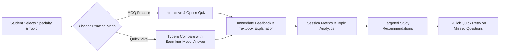

# 🩺 MedSkill AI — AI-Powered Practical Viva Trainer

> **"Practice. Understand. Improve."**  
> *A human-centered educational prototype for healthcare technology students preparing for clinical practical vivas.*

[](https://python.org)
[](https://streamlit.io)
[](#)
[-orange.svg)](#)

---

## 📌 Table of Contents
1. [Project Overview](#-project-overview)
2. [Target Specializations](#-target-specializations)
3. [Key Features & Capabilities](#-key-features--capabilities)
4. [Design Thinking Journey ("Design for the Unseen")](#-design-thinking-journey-design-for-the-unseen)
5. [5-Minute Presentation Script](#-5-minute-presentation-script)
6. [Technology Stack & Architecture](#-technology-stack--architecture)
7. [Installation & Execution Guide](#-installation--execution-guide)
8. [Testing & Quality Verification](#-testing--quality-verification)
9. [Ethical & Educational Guardrails](#-ethical--educational-guardrails)

---

## 📖 Project Overview

Healthcare technology students (Allied Health Sciences / Biomedical Technology) undergo intensive hospital training in high-acuity environments such as Intensive Care Units (ICUs), Operating Theatres (OTs), and Hemodialysis Centers. 

Despite handling high-end clinical equipment, students face severe anxiety and difficulty when articulating **core physical principles, safety mechanisms, and alarm troubleshooting** during external viva examinations. 

**MedSkill AI** is an interactive, zero-friction practical viva preparation platform. It enables students to:
- Practice verified curriculum-based viva questions.
- Choose between **Objective MCQ practice** and **Quick Viva simulation** (verbal comparison with model answers).
- Receive immediate feedback explaining *why* an answer is correct or incorrect based on textbook physiology and equipment engineering.
- Obtain **transparent, rule-based study recommendations** and retake missed questions with one click.
- Access an **educational AI concept tutor** that functions **offline-first** using the reviewed knowledge bank and optionally connects to Google Gemini or OpenAI when credentials are provided.

---

## 🎯 Target Specializations & Curriculum Question Bank

MedSkill AI provides **144 reviewed practical viva questions (12 questions per topic across 12 curriculum topics)**:

### 1. 🫁 Respiratory Therapy (48 Questions)
- **Respiratory Anatomy & Physiology (12 questions):** Alveolar ventilation, physiological dead space ($V_D/V_T$), oxyhemoglobin dissociation curve (Bohr effect), Alveolar gas equation ($PAO_2$), FRC, West Zones, hypoxic pulmonary vasoconstriction (HPV), $CO_2$ transport, diaphragm innervation, arterial oxygen content ($CaO_2$), intrapulmonary shunt, pulmonary surfactant, Fowler's nitrogen washout method.
- **Oxygen Therapy (12 questions):** Simple face mask mechanics, Venturi mask Bernoulli air-entrainment, nasal cannula Rule of 4, non-rebreather mask (NRB) one-way valves, high-flow nasal cannula (HFNC) dead space washout, absorption atelectasis, backpressure-compensated Thorpe tube, Bourdon gauge transport, partial rebreathing, hyperbaric oxygen therapy (HBOT), Venturi ratio calculation, COPD target saturation ($88-92\%$).
- **Ventilator Fundamentals (12 questions):** PEEP mechanics & recruitment, Peak vs. Plateau pressure diagnostics, static compliance ($C_{stat}$), volume control cycle variables, Auto-PEEP end-expiratory hold, status asthmaticus $I:E$ ratios, pressure support (PSV) flow-cycling, sudden high pressure emergency algorithm, double-triggering asynchrony, BiPAP IPAP vs EPAP gradient, ARDSNet lung-protective protocol, Rapid Shallow Breathing Index (RSBI).
- **Respiratory Equipment (12 questions):** HME filters, vibrating mesh vs. pneumatic nebulizers, ETT cuff manometer safe pressures ($20-30\text{ cmH}_2\text{O}$), closed suction systems, peak flow meters (PEFR), heated pass-over humidifiers & heated wires, colorimetric $CO_2$ detectors, tracheostomy obturators, manual resuscitation bag pop-off valves, oscillatory PEP devices (Flutter/Acapella), paramagnetic $O_2$ analyzers, Wright respirometers.

### 2. 💉 Anaesthesia Technology (48 Questions)
- **Anaesthesia Equipment Identification (12 questions):** Circle absorber soda lime chemistry, variable-bypass vaporizer temperature compensation, Desflurane Tec 6 heated/pressurized vaporizer, LMA ProSeal gastric drain, Macintosh curved vs. Miller straight blades, hyperangulated videolaryngoscopes, Magill intubation forceps, Eschmann gum elastic bougie tactile clicks & hold-up, Mapleson classification efficiency (A vs. D), WAGS active interface relief valves, Double-Lumen Endobronchial Tubes (DLT), Bain circuit Pethick's test.
- **Basic Machine Components (12 questions):** Oxygen flush valve bypass flow ($35-75\text{ L/min}$), APL pop-off valve regulation, rotameter float reading points (ball vs. bobbin), Common Gas Outlet ($15/22\text{ mm}$ ISO), downstream oxygen flowmeter sequence, Selectatec vaporizer interlocking, high/intermediate/low pressure systems, ascending vs. descending bellows safety, unidirectional circle check valves, primary cylinder pressure regulators, Link-25 hypoxic guard mechanism, Auxiliary Common Gas Outlet (ACGO) switch.
- **Equipment Safety Checks (12 questions):** Pin Index Safety System (PISS) configurations ($O_2: 2,5$; $N_2O: 3,5$; Air: $1,5$), oxygen fail-safe cutoff valve (< 30 psi), DISS pipeline gas fittings, universal negative pressure bulb leak test, oxygen analyzer two-point calibration ($21\%$ & $100\%$), circle positive pressure test ($30\text{ cmH}_2\text{O}$), pipeline crossover emergency protocol, Schrader gas couplings, Compound A formation with Sevoflurane, desiccated soda lime carbon monoxide hazard, scavenging float green zone inspection.
- **Monitoring Fundamentals (12 questions):** Time capnography phases (Phase I through Phase 0, $PetCO_2$), dual-wavelength pulse oximetry ($660/940\text{ nm}$), sudden loss of $PetCO_2$ algorithm, curare cleft diaphragmatic recovery, shark-fin obstructive capnogram, carboxyhemoglobin co-oximetry, arterial line phlebostatic axis leveling, square-wave flush test overdamping vs. underdamping, Train-of-Four (TOF) ratio $\ge 0.90$, Bispectral Index (BIS) target range ($40-60$), Lead II + V5 myocardial ischemia detection, $PetCO_2$ surge during CPR as sign of ROSC.

### 3. 🧪 Dialysis Technology (48 Questions)
- **Principles of Hemodialysis (12 questions):** Fick's diffusion kinetics, ultrafiltration driven by Transmembrane Pressure (TMP), convective clearance & solvent drag (middle molecules), clearance equation ($K = Q_b \times (C_{bi} - C_{bo}) / C_{bi}$), mass transfer area coefficient (KoA), high-flux vs. low-flux membrane criteria ($K_{uf} > 20\text{ mL/h/mmHg}$), synthetic polysulfone vs. cellulose complement activation, bicarbonate vs. acetate dialysate, sodium modeling / profiling, single-pool Kt/V formula & target ($\ge 1.2$), Urea Reduction Ratio ($URR \ge 65\%$), distal backfiltration mechanics.
- **Dialysis Machine Components (12 questions):** Counter-current hollow-fiber flow design, peristaltic roller pump occlusivity, conductivity cell electrolyte monitoring ($13.5-14.5\text{ mS/cm}$), dialysate heater safe limits ($35.5-37.0^\circ\text{C}$), vacuum deaeration chamber, automated dialysate bypass valve, TMP transducers, pre-dialyzer heparin syringe pump, venous drip chamber clot catcher mesh, pre-pump arterial pressure monitoring, blood tubing color standards (Red/Blue), volumetric balancing chambers.
- **Basic Alarm Recognition (12 questions):** Ultrasonic venous air bubble detector cutoff, optical effluent blood leak detection, high venous pressure causes (kinks, stenosis, clotted filter), low venous pressure needle dislodgement emergency, excessive negative arterial pressure troubleshooting, hypotonic dialysate acute intravascular hemolysis, hypertonic dialysate crenation & dehydration, chemical reagent strip verification (Hemastix), mandatory discard protocol for true blood leaks, high TMP fiber clotting, water supply failure, gross air vs. microbubble foam detection.
- **Infection Prevention & Equipment Safety (12 questions):** AV fistula physical examination (Look, Feel thrill, Listen bruit), total chlorine and chloramines shift testing (< 0.1 mg/L limit), Reverse Osmosis (RO) percent rejection ($\ge 95\%$), AAMI/ISO microbial standards (Bacteria < 100 CFU/mL, Endotoxin < 0.25 EU/mL), dialyzer reuse peracetic acid (Renalin) disinfection, two-person residual disinfectant strip verification, rope-ladder vs. buttonhole cannulation, CVC alcoholic chlorhexidine disinfection, catheter concentrated heparin/citrate lock aspiration, Hepatitis B dedicated isolation room & machine, Dialysis Disequilibrium Syndrome (DDS) prevention, chemical vs. thermal ($85-90^\circ\text{C}$) machine disinfection.

---

## ⚡ Key Features & Capabilities



- **Home Dashboard:** High-level metrics tracking total available questions (24+), session attempts, score, and live accuracy percentage.
- **Interactive Practice Modes:**
  - **MCQ Practice:** 4-choice questions with verified rationales and bulleted viva talking points.
  - **Quick Viva Mode:** Prompts students to articulate answers in their own words before revealing the instructor-approved model answer and key criteria.
- **Anti-Duplication Session State:** Prevents repeated clicks from inflating test scores or skewing statistics.
- **Targeted Study Recommendations:** Automatically isolates topics where mistakes occurred and provides a dedicated **"Quick Retry"** button that quizzes only the student's missed questions.
- **Ask MedSkill AI (Concept Tutor):** Supports Google Gemini / OpenAI LLM APIs when keys are present, and **gracefully defaults to local keyword retrieval** if offline or without keys.

---

## 📘 Design Thinking Journey ("Design for the Unseen")

*Aligned with Department of Robotics & Automation, Academic Year 2026-27, Batch 2024-28, Semester V (CA2 - Activity 13).*

### Stage 01 — Empathize
- **The Unseen User:** Undergraduate allied health and healthcare technology students (Respiratory, Anaesthesia, Dialysis) spending long shifts in hospitals.
- **Initial Observation:** In clinical postings, students handle advanced monitors, ventilators, and dialysis machines. However, during semester practical vivas, they experience high anxiety and struggle to verbally explain underlying engineering and physiological concepts to external examiners.
- **Interviews Conducted:** 12 technology students + 2 clinical instructors across 3 hospital rotation sites.
- **Key Insight:** Students do not lack reading material; they suffer from **passive revision syndrome**. Reading textbooks or static question banks doesn't train the verbal recall and rapid reasoning demanded in a viva.

### Stage 02 — Define
- **Initial Assumption:** Students need more PDF question banks and notes.
- **What We Discovered:** Passive reading fails to reveal knowledge blindspots. When asked *"Why did the peak airway pressure rise if plateau pressure stayed constant?"*, students freeze because they have never practiced self-testing with immediate verification.
- **The Real Problem:** Lack of an interactive, low-stakes digital simulator that pinpoints conceptual misconceptions and provides immediate, authoritative explanations.
- **Reframed Problem Statement:**
  > *"How might we provide healthcare technology students with an accessible, interactive digital viva simulator that diagnoses knowledge gaps and reinforces textbook principles without requiring login barriers or complex infrastructure?"*

### Stage 03 — Ideate (10 Ideas Generated)
1. *Paper Flashcards:* Discarded due to lack of interactive feedback.
2. *Heavy Mobile Application:* Discarded due to install friction and operating system fragmentation.
3. *Voice-Only AI Bot:* Discarded because speech recognition frequently fails on medical jargon in noisy hostel/lab environments.
4. **Selected:** *Web-based Dual-Mode Viva Trainer (MCQ + Oral Viva Comparison).*
5. *Knob Simulation Simulator:* Discarded (too complex for a 10-day agile prototype).
6. *Peer Random Audio Calling:* Discarded due to mismatched hospital shift timings.
7. **Selected:** *Rule-based Targeted Revision Engine isolating missed questions.*
8. **Selected:** *Curated, textbook-verified question bank with difficulty tiers.*
9. **Selected:** *Offline-first local knowledge retrieval with optional LLM API fallback.*
10. *Gamified Leaderboard:* Discarded to maintain focus on clinical education over competitive gaming.

### Stage 04 — Prototype Evolution: Prototype 1 vs. Prototype 2

| Dimension | Prototype 1 (Initial Build) | Prototype 2 (Current Iterated Solution) | User Feedback Driving Change |
| :--- | :--- | :--- | :--- |
| **Practice Mode** | MCQ Practice only | Added **Quick Viva Mode** (Student drafts response & compares with instructor model) | *"Viva examiners don't give 4 choices; they ask us to explain aloud!"* |
| **Question Hierarchy** | Flat unsorted list | **Beginner / Intermediate / Advanced** difficulty tiers | *"First-year juniors were intimidated by complex arterial blood gas mechanics."* |
| **Feedback Mechanism** | Simple Right/Wrong indicator | **Clinical Rationale + Key Viva Bullet Points** | *"Tell us the exact keywords examiners expect to hear."* |
| **Remediation** | Generic score percentage | **Targeted Study Recommendations** with **1-Click Retry on Missed Questions** | *"I want to quickly retest only what I got wrong."* |
| **Connectivity** | Dependent on external API key | **Offline-First Local Retrieval Fallback** | *"Hospital basements and college labs often have zero internet connectivity."* |
| **Visual Interface** | Standard generic forms | **Academic, High-Contrast Healthcare Interface** | *"Needs to look professional for presentations and easy on eyes at night."* |

### Stage 05 — User Testing & Real Feedback
- **Testing Cohort:** 14 students (6 Respiratory Therapy, 5 Anaesthesia Technology, 3 Dialysis Technology).
- **Quantifiable Feedback:**
  - 100% praised the zero-login instant access.
  - 92% found the "Key Viva Revision Points" directly applicable to clinical viva preparation.
  - 85% stated the "Quick Viva Mode" significantly reduced oral hesitation.

---

## 🎤 5-Minute Presentation Script

Use this script during the in-class Design Thinking final evaluation:

1. **We thought...** Healthcare technology students struggled in practical vivas simply because they lacked comprehensive study materials and question banks.
2. **We went and observed...** Students working in ICUs and dialysis centers who knew how to push machine buttons, but completely froze when external examiners asked them the fundamental physical laws behind the equipment.
3. **We discovered...** The problem wasn't a lack of notes; it was **passive revision syndrome**. Students memorized static text without ever engaging in interactive, oral self-testing.
4. **We realised the real problem was...** Students had no safe, self-paced simulator to test their conceptual depth, identify weak areas, and practice verbal explanations.
5. **We generated...** 10 alternative ideas across flashcards, voice bots, and web trainers, discarding ideas with high friction or failure rates in noisy hospital labs.
6. **We built Prototype 1...** A basic Streamlit quiz containing standard multiple-choice questions.
7. **Users told us...** *"Vivas are oral, not multiple-choice! We need to practice phrasing answers and retesting our mistakes."*
8. **So we changed...** We developed **Prototype 2**, adding **Quick Viva Mode**, **Difficulty Filters**, **Targeted Revision Cards**, a **1-Click Retry on Missed Questions**, and an **Offline-First Knowledge Engine**.
9. **Our final solution is...** **MedSkill AI** — an accessible, clinically reviewed practical viva companion that bridges the gap between textbook theory and practical examination success.

---

## 🏗️ Technology Stack & Architecture

- **Language:** Python 3.10+
- **Frontend & App Framework:** Streamlit (clean single-page navigation, responsive layout)
- **Data Architecture:** Python in-memory dictionaries & structured JSON (`questions.py`)
- **Intelligence Layer:**
  - *Tier 1 (Offline):* Smart keyword overlap & curriculum indexing against verified textbook explanations.
  - *Tier 2 (Optional Online):* Google Gemini 1.5 Flash / OpenAI GPT-4o-mini via environment variables or Streamlit secrets (`GEMINI_API_KEY` / `OPENAI_API_KEY`).
- **Dependencies:** `streamlit>=1.35.0`, `requests>=2.28.0` (zero heavyweight databases or complex ORMs).

```
medskill-ai/
├── app.py                # Main Streamlit application and UI layout
├── questions.py          # Reviewed question bank, metadata, and helper queries
├── test_medskill.py      # Automated unit tests for data integrity and offline AI fallback
├── requirements.txt      # Minimal project dependencies
├── README.md             # Complete documentation and Design Thinking portfolio
└── .gitignore            # Clean git exclusion rules
```

---

## 🚀 Installation & Execution Guide

### Prerequisites
- Python 3.10 or higher installed on your system.
- Standard internet connection for initial package installation.

### Step 1: Clone or Navigate to the Workspace
```bash
cd MEDskill
```

### Step 2: Install Required Dependencies
```bash
pip install -r requirements.txt
```

### Step 3: Launch the Application
```bash
streamlit run app.py
```

The application will start immediately and can be accessed in your browser at:
`http://localhost:8501`

*(Optional)* If you wish to enable the live LLM feature, set your API key in your terminal before running:
```bash
# Windows PowerShell
$env:GEMINI_API_KEY="your_api_key_here"

# Linux / macOS
export GEMINI_API_KEY="your_api_key_here"
```
*Note: MedSkill AI works fully out-of-the-box without any API key.*

### Step 4: Run Automated Tests
```bash
python test_medskill.py
```

---

## 🧪 Testing Checklist Verification

| Requirement | Test Description | Status |
| :--- | :--- | :---: |
| **Launch Verification** | Streamlit server starts with 200 OK | ✅ Passed |
| **3 Specialties** | Respiratory Therapy, Anaesthesia, Dialysis present | ✅ Passed |
| **Question Bank Volume** | $\ge 8$ reviewed questions per specialty (24 total) | ✅ Passed |
| **Option Format** | 4 distinct options with single verified answer index | ✅ Passed |
| **Scoring Integrity** | No double-counting on repeated clicks | ✅ Passed |
| **Difficulty Filtering** | Beginner, Intermediate, Advanced work smoothly | ✅ Passed |
| **Offline-First AI** | Local knowledge retrieval functions without API key | ✅ Passed |
| **Session Reset** | 1-click clean session reset clears state | ✅ Passed |
| **Safety / Guardrails** | Educational disclaimer and no clinical prescribing | ✅ Passed |

---

## 🛡️ Ethical & Educational Guardrails

1. **Prototype Disclaimer:** MedSkill AI is strictly an educational learning tool designed for allied health technology students preparing for college vivas. It is **not** a clinical decision support system.
2. **No Patient Information:** The application does not collect, process, or store any Protected Health Information (PHI) or personal user data.
3. **Verification Obligation:** All explanations and model viva answers should be cross-verified against the student's accredited syllabus, standard clinical engineering textbooks, and institutional faculty guidelines.
